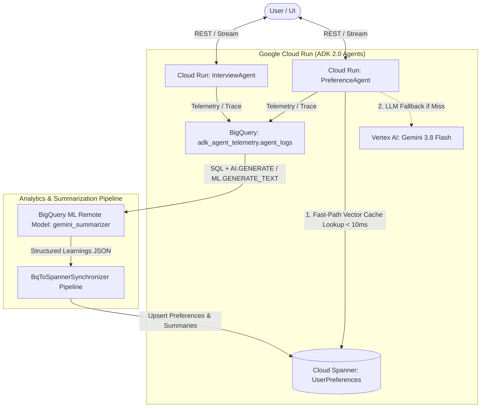

# Google ADK 2.0 Multi-Agent Demo: BigQuery Telemetry, AI.GENERATE Summarization & Spanner Smart Cache

A complete, end-to-end production-grade AI agent demonstration built with the **Google Agent Development Kit (ADK) 2.0**, featuring automated telemetry export to **Google BigQuery**, SQL-based session summarization using **BigQuery AI / ML.GENERATE_TEXT**, persistence to **Google Cloud Spanner**, a fast-path lookup agent deployed on **Google Cloud Run** via **Terraform**, and a Material Light UI web control center.

---

## 📑 Table of Contents
1. [📖 How to Use the App (Web Control Center Walkthrough)](#-how-to-use-the-app-web-control-center-walkthrough)
2. [🌐 Accessing Live Services & Programmatic Endpoints](#-accessing-live-services--programmatic-endpoints)
3. [🚀 Running Locally with uv](#-running-locally-with-uv)
4. [☁️ Deploying to Google Cloud Run (Source Script & Terraform)](#-deploying-to-google-cloud-run-source-script--terraform)
5. [🔒 Security, Environment Variables & IAP Proxy Setup](#-security-environment-variables--iap-proxy-setup)
6. [🏛️ Architecture & Data Flow](#-architecture--data-flow)
7. [📊 BigQuery SQL Summarization & Spanner Vector Queries](#-bigquery-sql-summarization-example)

---

## 📖 How to Use the App (Web Control Center Walkthrough)

The **Material Light UI Control Center** provides an interactive dashboard to explore the multi-agent lifecycle, observe real-time telemetry, and test long-term memory consolidation.

### 1. Sign In / Authenticate
- Navigate to your deployed UI Service URL (e.g., `https://ui-service-<project-hash>.<region>.run.app` or `$UI_SERVICE_URL` from your `.env` file, or `http://localhost:8080` when running locally).
- Sign in with an authorized Google account via Firebase Authentication, OR click **"Bypass Auth (Local Developer)"** when running in developer/mock mode.

### 2. Step 1 — Conduct an Interview (`InterviewAgent`)
- Select the **Interview Agent** tab.
- Send conversational messages sharing your personal preferences, favorite programming languages, cloud architecture stack, job role, and work style.
- The `InterviewAgent` records your answers using Google ADK 2.0 tools and emits real-time telemetry spans to Google BigQuery (`adk_agent_telemetry.agent_logs`).

### 3. Step 2 — Trigger a Dream Harvest (`REM Sleep Memory Synthesis`)
- Click **Trigger Dream Harvest** in the top action bar (or invoke `POST /api/harvest`).
- This initiates an asynchronous REM sleep memory consolidation cycle:
  1. Full session transcripts are queried from BigQuery.
  2. **BigQuery AI (`ML.GENERATE_TEXT`)** analyzes the transcript and extracts structured JSON user profile preferences.
  3. 768-dimensional vector embeddings are generated and upserted into **Google Cloud Spanner** (`UserPreferences`).

### 4. Step 3 — Test Fast-Path Preference Lookups (`PreferenceAgent`)
- Select the **Preference Agent** tab.
- Ask questions about your stored preferences (e.g., *"What is my favorite programming language and job role?"*).
- Notice that the response is returned in `< 10ms` (`source: "SPANNER_CACHE"`) via **vector similarity search (`COSINE_DISTANCE`)** without consuming any LLM inference tokens.

### 5. Step 4 — Inspect Crystalline Memory & Telemetry
- Click the **Spanner Memory** tab to view your stored relational profile preferences and confidence scores.
- Click the **Telemetry Logs** tab to inspect the raw BigQuery interaction history.

---

## 🌐 Accessing Live Services & Programmatic Endpoints

All microservices can be run locally or deployed to Google Cloud Run in your Google Cloud project (configured via `GOOGLE_CLOUD_PROJECT` in your `.env` file) using default model **`gemini-3.8-flash`**.

### 1. Configuring Service URLs (`.env` file)
Copy `.env.example` to `.env` to configure your GCP project ID and service endpoints:
```bash
cp .env.example .env
```
Configure your environment in `.env`:
```dotenv
GOOGLE_CLOUD_PROJECT=your-gcp-project-id
GOOGLE_CLOUD_REGION=us-central1

# Local development defaults:
PORT=8080
UI_SERVICE_URL=http://localhost:8080
INTERVIEW_AGENT_URL=http://localhost:8081
PREFERENCE_AGENT_URL=http://localhost:8082

# When deployed to Google Cloud Run, retrieve your live URLs via:
# gcloud run services list --project=$GOOGLE_CLOUD_PROJECT
# UI_SERVICE_URL=https://ui-service-<hash>.<region>.run.app
# INTERVIEW_AGENT_URL=https://interview-agent-<hash>.<region>.run.app
# PREFERENCE_AGENT_URL=https://preference-agent-<hash>.<region>.run.app
```

### 2. Web UI Control Center (Browser Access)
- **Local Control Center**: `http://localhost:8080`
- **Cloud Run Control Center**: Open `$UI_SERVICE_URL` (configured from your `.env` file or deployment output) in any browser to interact with the **InterviewAgent**, view live **BigQuery Telemetry Logs**, execute a **Dream Harvest**, inspect stored **Google Cloud Spanner Memory**, and test the **PreferenceAgent** fast-path Spanner cache hits.

### 3. Service Base URLs
| Service Name | Example Cloud Run URL (From `.env`) | Local Development URL |
| :--- | :--- | :--- |
| **UI Service (Control Center)** | `https://ui-service-<hash>.<region>.run.app` (`$UI_SERVICE_URL`) | `http://localhost:8080` |
| **InterviewAgent** | `https://interview-agent-<hash>.<region>.run.app` (`$INTERVIEW_AGENT_URL`) | `http://localhost:8081` |
| **PreferenceAgent** | `https://preference-agent-<hash>.<region>.run.app` (`$PREFERENCE_AGENT_URL`) | `http://localhost:8082` |

### 4. Programmatic REST API Endpoints
All endpoints return structured JSON and can be called programmatically via `curl`, Python, or any HTTP client:

| Endpoint | Method | Description | Example Payload |
| :--- | :--- | :--- | :--- |
| `/health` | `GET` | Health & model check | N/A |
| `/api/interview/query` | `POST` | Chat with InterviewAgent & record BigQuery telemetry | `{"user_id": "user-01", "session_id": "sess-01", "prompt": "My favorite language is Python"}` |
| `/api/logs/{session_id}` | `GET` | Retrieve session telemetry logs from BigQuery | N/A |
| `/api/harvest` | `POST` | Trigger Dream Harvest (summarize BQ logs -> sync to Spanner) | `{"user_id": "user-01", "session_id": "sess-01"}` |
| `/api/spanner/preferences/{user_id}` | `GET` | Fetch stored user profile preferences from Spanner | N/A |
| `/api/preference/query` | `POST` | Query PreferenceAgent with fast Spanner cache hit (< 10ms) | `{"user_id": "user-01", "session_id": "sess-01", "prompt": "What is my favorite language?"}` |

### 5. Agent Prompt & Response Payloads (Code Block Formatting)

When interacting with `InterviewAgent` or `PreferenceAgent`, all prompts, responses, and structured payloads should be formatted within fenced markdown code blocks (` ```json `, ` ```python `, ` ```sql `) for clear readability and syntax highlighting.

#### A. InterviewAgent Prompt & Response (`POST /api/interview/query`)
**User Prompt Payload (`USER_PROMPT`):**
```json
{
  "user_id": "demo-user-42",
  "session_id": "session-ui-001",
  "prompt": "My favorite programming language is Python and my job role is Principal Cloud Architect.\n\nHere is a snippet of my preferred Python agent code:\n```python\nfrom google.adk.agents import Agent\n\nagent = Agent(name=\"DemoAgent\", model=\"gemini-3.8-flash\")\n```"
}
```

**Agent Response Payload (`AGENT_RESPONSE`):**
```json
{
  "response": "Hello Alex! I've recorded **Python** as your favorite programming language and **Principal Cloud Architect** as your job role.\n\nYour Python agent configuration snippet:\n```python\nfrom google.adk.agents import Agent\nagent = Agent(name=\"DemoAgent\", model=\"gemini-3.8-flash\")\n```\nWill be logged to BigQuery and crystallized into Spanner during REM synthesis.",
  "user_id": "demo-user-42",
  "session_id": "session-ui-001",
  "agent_name": "InterviewAgent",
  "recorded_answers": [
    {
      "topic": "favorite_programming_language",
      "answer": "Python",
      "category": "technical"
    },
    {
      "topic": "job_role",
      "answer": "Principal Cloud Architect",
      "category": "role"
    }
  ]
}
```

#### B. PreferenceAgent Fast-Path Prompt & Response (`POST /api/preference/query`)
**User Prompt Payload (`USER_PROMPT`):**
```json
{
  "user_id": "demo-user-42",
  "session_id": "session-ui-001",
  "prompt": "What is my favorite programming language and job role in Spanner?"
}
```

**Agent Response Payload (`AGENT_RESPONSE` — Fast Cache Hit `< 10ms`):**
```json
{
  "response": "According to your crystalline Spanner memory:\n- **Favorite Language**: Python (`confidence: 0.98`)\n- **Job Role**: Principal Cloud Architect (`confidence: 0.95`)\n\nRetrieved via `COSINE_DISTANCE` vector similarity search in `< 10ms`.",
  "user_id": "demo-user-42",
  "session_id": "session-ui-001",
  "agent_name": "PreferenceAgent",
  "source": "SPANNER_CACHE",
  "latency_ms": 6.42
}
```

### 6. Automated Live Programmatic Validation
You can programmatically validate all 7 live Google Cloud Run endpoints using the included validator script. The script automatically reads your target endpoints from `.env` (or environment variables):
```bash
python3 -m scripts.validate_live_endpoints
```

### 7. Critical Development & Deployment Policy
> [!IMPORTANT]
> **Deployed State Testing Required**: Any code, UI, or prompt changes MUST be tested in the deployed state on Google Cloud Run (in your target Google Cloud project). Local unit tests (`uv run pytest`) are necessary but not sufficient.
> **Deployment as Final Step**: Deploying to Google Cloud Run (via `./scripts/deploy_cloud_run_source.sh`) and validating live endpoints (`python3 -m scripts.validate_live_endpoints`) MUST be the final step of any feature development or modification.

---

## 🏛️ Architecture & Data Flow



### 1. **InterviewAgent (Profile Builder)**
- Built using **Google ADK 2.0** (`google.adk.agents.Agent`, `google.adk.apps.app.App`).
- Conducts interactive interviews with users to collect preferences (e.g., name, favorite programming languages, technical stack, job role, and work style).
- Uses ADK tools (`record_user_answer`, `get_recorded_answers`) to track answers within the session.
- Emits real-time telemetry (prompts, responses, tokens, timestamps) to Google BigQuery and OpenTelemetry Cloud Trace.

### 2. **BigQuery Telemetry & AI.GENERATE Session Summarization**
- All agent interactions (`USER_PROMPT` and `AGENT_RESPONSE`) are captured in the BigQuery table `adk_agent_telemetry.agent_logs`.
- Using **BigQuery ML / AI.GENERATE_TEXT** (`ML.GENERATE_TEXT` with Vertex AI remote models), SQL scripts (`sql/bq_summarize_sessions.sql`) aggregate full conversation transcripts and automatically extract structured user preferences into JSON format.

### 3. **Google Cloud Spanner Memory Storage**
- The summarized learnings are synchronized into a **Google Cloud Spanner** relational schema (`UserPreferences` and `UserSessionSummaries`).
- Provides transactional, strongly-consistent storage for user profiles across sessions.

### 4. **PreferenceAgent (Smart Spanner Vector Cache Lookup)**
- A specialized version of the agent that answers user questions about their profile and past answers.
- **Fast-Path Vector Cache Optimization**: When queried, `PreferenceAgent` inspects Google Cloud Spanner using **vector similarity search (`COSINE_DISTANCE`)** over 768-dimensional semantic embeddings. If matching preferences are found, it returns the stored answers immediately (zero LLM tokens, latency `< 10ms`) instead of executing an expensive LLM call.
- Emits BigQuery telemetry indicating cache hit (`source="SPANNER_CACHE"`) or LLM delegation (`source="LLM_FALLBACK"`).

---

## 🧠 Best Practices: AI Agent "Dreaming" & Multi-Method Memory Retrieval

This project implements industry best practices for long-term LLM memory consolidation (**"Agent Dreaming"**) and multi-strategy semantic retrieval:

### 1. The REM Sleep Analogy for AI Agents (Two-Stage Memory Architecture)
- **Waking State (Episodic / Short-Term Memory)**: During live conversation, all user interactions and agent responses stream into **Google BigQuery** (`adk_agent_telemetry.agent_logs`). This acts as raw episodic memory—fast to record, but noisy, fragmented, and redundant.
- **REM Synthesis / Dream Harvest (Asynchronous Memory Consolidation)**: Rather than writing raw user inputs directly into a database, the `/api/harvest` endpoint acts as an offline "Dream Cycle". It passes the episodic session logs to **Vertex AI Gemini (`gemini-3.8-flash`)** with an explicit REM Memory Consolidation instruction.
  - Removes conversational noise and resolves contradictions.
  - Keeps identity attributes (`name`) completely separate from occupational roles (`job_role`).
  - Crystallizes beliefs into complete, self-contained natural language semantic vectors/schemas (`CrystallizedBelief`).

### 2. High-Value LLM Memory Schema (`UserPreferences` in Google Cloud Spanner)
A robust agentic memory schema must support both structured lookups and semantic similarity. Our Spanner DDL schema includes:
- **`PreferenceKey` & `PreferenceValue`**: Canonical snake_case identifiers (`favorite_language`, `job_role`, `name`, `preferred_tools`, `work_style`) and exact string values (`Python`, `Principal Cloud Architect`, `Alex`).
- **`Category` & `Confidence`**: Domain taxonomy (`profile`, `technical`, `role`, `infrastructure`) and a 0.0–1.0 belief confidence score.
- **`CrystallizedBelief` (LLM Semantic Document/Vector)**: A full natural language statement synthesized during the Dream Cycle (e.g., *"The user works as a Principal Cloud Architect specializing in cloud infrastructure."*).
- **`Keywords` (Search Tags & Synonyms)**: Normalized keywords and synonyms (e.g., *"python, programming, language, code, coding"* or *"architect, principal, cloud, role, job, title, career"*) to support multi-angle retrieval.
- **`Embedding` (`ARRAY<FLOAT64>(768)`)**: A 768-dimensional semantic embedding vector indexed with a Spanner `VECTOR INDEX` for approximate nearest neighbor (ANN) lookups using `COSINE_DISTANCE`.

### 3. Multi-Method Hybrid Retrieval Engine (`PreferenceAgent`)
To overcome the limitations of brittle exact-match or pure text lookups, `PreferenceAgent` implements a vector similarity retrieval pipeline:
1. **Semantic Vector Embedding Generation**: Converts user query prompts into 768-dimensional normalized embedding vectors (`@query_vector`).
2. **Spanner Vector Similarity Lookup (`COSINE_DISTANCE`)**: Executes a Spanner SQL query ordering rows by `COSINE_DISTANCE(Embedding, @query_vector) ASC`, eliminating pure text substring or keyword matching.
3. **Multi-Fact Crystallized Belief Synthesis**: Rather than returning on the first matched record and dropping compound questions, the retrieval engine collects **all matching Spanner records below the distance threshold** and synthesizes a comprehensive, multi-fact response (< 10ms latency, zero LLM tokens).

---

## 📁 Repository Structure

```text
electric-sheep/
├── pyproject.toml               # Package dependencies & uv test configuration
├── README.md                    # Architecture & documentation
├── terraform/                   # Production-grade Terraform IaC
│   ├── main.tf                  # Provider setup & GCP API enablement
│   ├── variables.tf             # Configurable variables
│   ├── outputs.tf               # Infrastructure outputs (URLs, BQ/Spanner IDs)
│   ├── bigquery.tf              # BigQuery Dataset, Telemetry Table & ML Remote Model
│   ├── spanner.tf               # Spanner Instance, Database & Schema DDL
│   ├── cloud_run.tf             # Cloud Run services for both ADK agents and UI
│   ├── iam.tf                   # Service Accounts & least-privilege IAM roles
│   └── terraform.tfvars.example # Sample variable configurations
├── sql/
│   ├── bq_schema.sql            # BigQuery telemetry table schema
│   ├── bq_summarize_sessions.sql # SQL query using ML.GENERATE_TEXT / AI.GENERATE
│   └── spanner_schema.sql       # Spanner DDL for UserPreferences & UserSessionSummaries
├── src/
│   ├── common/
│   │   ├── config.py            # Central environment & runtime configuration
│   │   ├── telemetry.py         # OpenTelemetry & BigQuery Telemetry Sink
│   │   └── spanner_client.py    # Spanner preference client (live & mock modes)
│   ├── interview_agent/
│   │   ├── __init__.py          # Exports ADK App and Agent
│   │   ├── agent.py             # ADK 2.0 InterviewAgent definition & tools
│   │   └── server.py            # FastAPI REST API & telemetry logging
│   ├── preference_agent/
│   │   ├── __init__.py          # Exports ADK App and Agent
│   │   ├── agent.py             # ADK 2.0 PreferenceAgent with Spanner lookup tools
│   │   └── server.py            # FastAPI REST API with fast-path Spanner caching
│   ├── ui_service/
│   │   ├── __init__.py          # Exports UI API server
│   │   ├── server.py            # FastAPI backend & API proxy
│   │   └── static/              # Vanilla HTML/CSS/JS Material Light UI
│   └── pipeline/
│       └── bq_to_spanner_sync.py # Synchronizes BQ AI summaries to Spanner
├── scripts/
│   ├── demo_flow.py             # Interactive end-to-end workflow demo
│   ├── validate_live_endpoints.py # Programmatic live GCP endpoint validator
│   └── seed_mock_data.py        # Seeding utility for testing
└── tests/                       # Unit and integration test suite (uv / pytest)
```

---

## 🚀 Running Locally with `uv`

This project is configured for **`uv`**, Python's fast dependency manager.

### 1. Install Dependencies
```bash
uv sync --dev
```

### 2. Run the End-to-End Demo Script
The demo script runs through the entire multi-agent lifecycle (interviewing, BigQuery telemetry logging, session summarization, Spanner storage, and fast-path PreferenceAgent lookups):
```bash
uv run python -m scripts.demo_flow
```

### 3. Run the Test Suite
Execute all unit and integration tests using `pytest` via `uv`:
```bash
uv run --extra dev pytest -v
```

### 4. Run the Local Web Control Center & Microservices
You can launch the Material Light UI Control Center and backend agents locally on your machine. By default, local execution uses deterministic mock mode (`USE_MOCK_CLIENTS=true`) so no Google Cloud credentials or network connections are required:
```bash
# Terminal 1: Launch InterviewAgent (Port 8081)
uv run uvicorn src.interview_agent.server:api --port 8081 --reload

# Terminal 2: Launch PreferenceAgent (Port 8082)
uv run uvicorn src.preference_agent.server:api --port 8082 --reload

# Terminal 3: Launch UI Service (Port 8080)
uv run uvicorn src.ui_service.server:api --port 8080 --reload
```
Once started, open `http://localhost:8080` in your browser and click **"Bypass Auth (Local Developer)"** on the login screen.

---

## ☁️ Deploying to Google Cloud Run (Source Script & Terraform)

You can deploy `electric-sheep` to Google Cloud using either the automated source deployment script or Terraform Infrastructure as Code (IaC).

### Method 1: Automated Source Deployment (Recommended for Updates & Feature Releases)
Use [deploy_cloud_run_source.sh](scripts/deploy_cloud_run_source.sh) to build and deploy all three microservices directly from source:
```bash
./scripts/deploy_cloud_run_source.sh
```
- **Automatic `.env` Loading**: If a `.env` file exists in the workspace root (excluded from Git via `.gitignore`), the script automatically loads your custom project ID, email domains, and Firebase settings.
- **Production Mode**: Automatically configures `USE_MOCK_CLIENTS=false` so deployed services connect to live Google Cloud Spanner, BigQuery, and Vertex AI endpoints.

### Method 2: Terraform Infrastructure as Code (`terraform/`)
The `terraform/` directory contains complete IaC to provision GCP APIs, BigQuery Datasets/Tables, Spanner Instances/Databases, IAM roles, and Cloud Run services from scratch.

1. **Initialize Terraform**:
   ```bash
   cd terraform
   terraform init
   ```
2. **Format and Validate (Mandatory Rule)**:
   ```bash
   terraform fmt
   terraform validate
   terraform plan -out=tfplan
   ```
3. **Apply Configuration**:
   ```bash
   terraform apply tfplan
   ```

### Security, Environment Variables & IAP Proxy Setup
When committing or deploying this repository:
- **Sensitive Secrets**: Real API keys, project IDs, and personal email addresses are sanitized from source defaults and templates. Never commit `.env` or `.tfvars` files containing live secrets (`.gitignore` excludes them automatically).
- **Identity-Aware Proxy (IAP) & Reverse Proxy Support**: You can secure Cloud Run or App Engine access using Google Cloud IAP or an authenticating reverse proxy by setting the following environment variables (or corresponding Terraform variables in `terraform/variables.tf`):
  - `IAP_ENABLED=true` (Enables IAP proxy JWT assertion and header checking)
  - `IAP_EXPECTED_AUDIENCE=/projects/YOUR_PROJECT_NUMBER/global/backendServices/YOUR_BACKEND_SERVICE_ID`
  - `IAP_HEADER_NAME=x-goog-iap-jwt-assertion`
  - `IAP_PROXY_URL=https://app.example.com`
- **Authorized Invokers**: Additional IAM members authorized to call internal backend Cloud Run services can be configured in Terraform via `authorized_invoker_members = ["user:developer@example.com"]`.

---

## 📊 BigQuery SQL Summarization Example

You can query agent session logs and generate structured profile summaries directly in BigQuery using `AI.GENERATE` / `ML.GENERATE_TEXT`:

```sql
-- Note: Replace `your-gcp-project-id` with your GCP project ID (GOOGLE_CLOUD_PROJECT from your .env file)
WITH SessionTranscripts AS (
  SELECT
    user_id,
    session_id,
    STRING_AGG(CONCAT(event_type, ': ', message), '\n' ORDER BY timestamp ASC) AS full_transcript,
    MAX(timestamp) AS last_interaction
  FROM `your-gcp-project-id.adk_agent_telemetry.agent_logs`
  WHERE agent_name = 'InterviewAgent'
  GROUP BY user_id, session_id
)
SELECT
  user_id,
  session_id,
  ml_generate_text_result['candidates'][0]['content']['parts'][0]['text'] AS generated_summary_json
FROM
  ML.GENERATE_TEXT(
    MODEL `your-gcp-project-id.adk_agent_telemetry.gemini_summarizer`,
    (
      SELECT CONCAT(
        'Extract user profile preferences into JSON with keys: user_id, summary, preferences (list of preference_key, preference_value, category, confidence). Transcript:\n',
        full_transcript
      ) AS prompt FROM SessionTranscripts
    ),
    STRUCT(0.2 AS temperature, 1024 AS max_output_tokens, TRUE AS flatten_json_output)
  );
```

---

## ⚡ Google Cloud Spanner Vector Input & Output Queries (`COSINE_DISTANCE`)

The `PreferenceAgent` uses **vector similarity search** rather than pure text or keyword matching. Below are the exact Spanner DDL and SQL query examples for inputting embeddings and querying them via `COSINE_DISTANCE`:

### 1. Spanner DDL with `ARRAY<FLOAT64>` (Standard & Enterprise Editions)
```sql
CREATE TABLE UserPreferences (
    UserId STRING(MAX) NOT NULL,
    PreferenceKey STRING(128) NOT NULL,
    PreferenceValue STRING(MAX) NOT NULL,
    Category STRING(64),
    SourceSessionId STRING(MAX),
    Confidence FLOAT64,
    CrystallizedBelief STRING(MAX),
    Keywords STRING(MAX),
    Embedding ARRAY<FLOAT64>,
    LastUpdated TIMESTAMP OPTIONS (allow_commit_timestamp=true)
) PRIMARY KEY (UserId, PreferenceKey);

-- Note: In Spanner ENTERPRISE Edition, you can specify ARRAY<FLOAT64>(VECTOR_LENGTH=>768)
-- and create a VECTOR INDEX for approximate nearest neighbor (ANN) similarity search:
-- CREATE VECTOR INDEX UserPreferencesByEmbedding ON UserPreferences(Embedding) OPTIONS (distance_type='COSINE');
```

### 2. Spanner Vector Input Query (Upserting with `@embedding` Parameter)
When user preferences are synthesized during the Dream Harvest, an embedding is generated and stored using the following parameterized DML query:
```sql
INSERT OR UPDATE UserPreferences (
    UserId, PreferenceKey, PreferenceValue, Category, SourceSessionId,
    Confidence, CrystallizedBelief, Keywords, Embedding, LastUpdated
) VALUES (
    @user_id, @pref_key, @pref_value, @category, @source_session_id,
    @confidence, @crystallized_belief, @keywords, @embedding, PENDING_COMMIT_TIMESTAMP()
);
```
- In the Python SDK, `@embedding` is passed with parameter type `spanner.param_types.Array(spanner.param_types.FLOAT64)`.

### 3. Spanner Vector Output Query (Vector Search with `COSINE_DISTANCE`)
When `PreferenceAgent` searches stored memory, it embeds the query prompt into `@query_vector` and executes the following SQL query:
```sql
SELECT
    UserId, PreferenceKey, PreferenceValue, Category, SourceSessionId,
    Confidence, CrystallizedBelief, Keywords, Embedding, LastUpdated,
    COSINE_DISTANCE(Embedding, @query_vector) AS distance
FROM UserPreferences
WHERE UserId = @user_id AND Embedding IS NOT NULL
ORDER BY COSINE_DISTANCE(Embedding, @query_vector) ASC
LIMIT 10;
```
- Results are ordered by ascending cosine distance (`COSINE_DISTANCE < 0.65`), ensuring semantic vector lookups rather than pure text matching.

