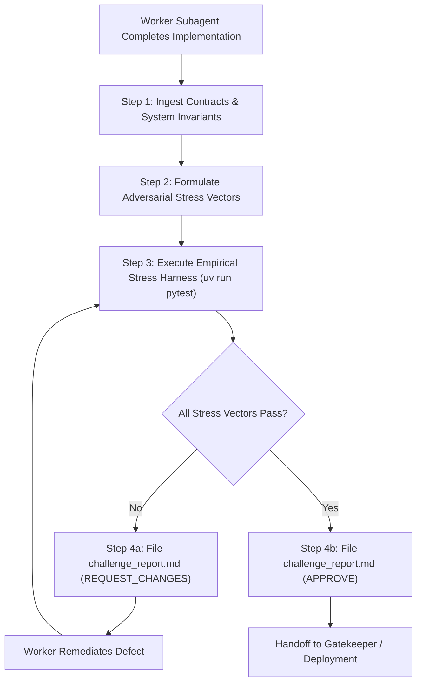

# Adversarial Subagent Challenger Skill

> [!IMPORTANT]
> **The Anti-Rubberstamp Mandate**: A standard reviewer checks syntax, formatting, and happy-path unit tests.
> The **Adversarial Challenger** exists to **actively break the implementation** by subjecting it to extreme boundary conditions, concurrency race hazards, statistical drift traps, scope contamination, and malformed telemetry schemas before any code is approved.

---

## 1. Why Adversarial Challenging in Software Systems & AI Agent Pipelines?

In distributed services, agent memory pipelines, and interactive data studios, high-severity regressions rarely appear in happy-path unit tests:
- **Boundary & Threshold Edge Traps**: Logic that passes nominal inputs fails when confidence scores, similarity thresholds ($T_{\text{crit}} \pm \epsilon$), token limits, or pagination offsets hit exact zero, negative, or maximum boundaries.
- **Concurrency & State Machine Race Hazards**: When concurrent requests or rapid state transitions arrive out of order, session state or database records can enter an inconsistent state or overwrite active mutations.
- **Statistical Drift & Scope Contamination**: If session logs contain noisy trajectories or mixed-workspace events, an un-hardened consolidation pipeline might miscalculate confidence distributions ($\mu, \sigma$) or leak workspace-scoped memories into global beliefs.
- **Silent Fallback & Mock Cheating**: An endpoint or evaluation harness might appear to pass by silently falling back to hardcoded defaults or synthetic arrays instead of surfacing genuine upstream failures.
- **High-Frequency API / WebSocket Backpressure**: Under rapid burst requests or streaming updates, connection pools or event queues can saturate, drop frames, or corrupt trajectory logs.

By dedicating an isolated subagent specifically to write and execute **adversarial stress vectors**, subtle boundary and concurrency regressions are caught and proven before production deployment.

---

## 2. The Challenger Workflow



### Step 1: Ingest Contracts & System Invariants
Review interface boundaries, domain invariants, and data contracts in the target repository:
- **Domain Models & Schemas**: Memory scopes (`GLOBAL`, `WORKSPACE`, `SESSION`), confidence bounds ($[0.0, 1.0]$), required provenance fields, and strict validation rules.
- **State Machines & Service Controllers**: Session lifecycle transitions, transaction locks, idempotency guarantees, and error propagation.
- **Consolidation & Retrieval Algorithms**: Trajectory clustering thresholds, promotion criteria, and vector/keyword ranking logic.
- **REST / WebSocket API Contracts**: Status codes, error payloads, pagination limits, and streaming frame ordering.
- **UI Layout & DOM Invariants**: Top App Bar 2-Child Standard (`.app-nav` inside `.app-title-group`), `.app-body-layout` consistency, and zero false affordances.

### Step 2: Formulate 5 Core Adversarial Stress Vectors
Design targeted stress vectors to test system resilience:
1. **Boundary & Threshold Pressure ($T_{\text{crit}} \pm \epsilon$, Empty / Max Payloads)**:
   - Drive numeric thresholds to $0.999 \times T_{\text{crit}}$ and $1.001 \times T_{\text{crit}}$, and test empty collections, single-element arrays, and maximum payload limits. Verify exact boundary behavior without off-by-one errors.
2. **Concurrency, Interlock & State Machine Race Hazards**:
   - Trigger concurrent state mutations or interleaved async requests on the same session/entity. Verify deterministic serialization, idempotency, and zero orphaned or corrupted state records.
3. **Scope Isolation & Statistical Contamination**:
   - Inject skewed or noisy trajectories across multiple workspaces and sessions. Verify that memory retrieval and consolidation strictly isolate scopes (`WORKSPACE_A` never leaks into `WORKSPACE_B` or `GLOBAL`) and resist outlier distortion.
4. **Schema Fuzzing & Malformed Payload Injection**:
   - Send payloads with missing required fields, negative counts, `NaN`/`Infinity` floats, SQL/prompt injection strings, or deeply nested JSON. Assert structured validation errors (e.g., HTTP 422) without unhandled 500 crashes.
5. **API / WebSocket Burst Flood & Backpressure**:
   - Simulate rapid back-to-back requests or streaming events. Verify that responses arrive in sequence, memory usage remains bounded, and all records are persisted accurately.

### Step 3: Execute Empirical Stress Harness
The challenger writes dedicated adversarial tests (e.g., in `tests/test_adversarial_*.py`) and executes them directly:
```bash
uv run pytest -v tests/test_adversarial_*.py
```

### Step 4: Strict Separation of Labor & Cross-Model Orthogonality
- **Cross-Model / Orthogonal Challenger Selection**:
  - Never use a lower-tier model (`flash`) to challenge a frontier model (`gemini-4-argon`, `claude-opus-5.5`). When the root session is on `gemini-4-argon` or `claude-opus-5.5`, always set `Model: "inherit"` (avoids `locations/us/gemini-3.1-pro-preview` 404s from `Model: "pro"` while preserving frontier reasoning), or dispatch to a cross-family frontier model (**Opus 5.5 challenging Gemini 4 Argon**, or **Gemini 4 Argon challenging Opus 5.5 / Sonnet 5.5 / Flash 3.8**).
  - **Context-Zero Blind Intake**: Do **not** feed the builder's chain-of-thought or self-justification into the Challenger prompt. Provide only the verbatim user spec, `RATERS.md` / `AGENTS.md` invariants, `git diff`, and `ast_blast_radius` output so the Challenger's priors remain independent.
- **Do NOT Patch the Worker's Code**: The challenger surfaces reproducible failing assertions; it does not write the feature fix itself. This preserves adversarial independence and prevents confirmation bias.
- **Deliver Structured Report**: Write the results to `challenge_report.md` with an explicit verdict (`APPROVE` or `REQUEST_CHANGES`).

---

## 3. Standard `challenge_report.md` Format

```markdown
# Challenge Report: [Component / Subsystem Name]

**Target**: `src/services/memory_service.py` / `src/api/routes.py`
**Challenger**: Adversarial Subagent (Challenger-1)
**Date**: YYYY-MM-DD
**Verdict**: [APPROVE | REQUEST_CHANGES]

---

## Stress Test Results Table

| Category / Vector | Expected Behavior | Actual Behavior | Verdict |
| :--- | :--- | :--- | :--- |
| **Threshold Boundary ($T_{\text{crit}} \pm \epsilon$)** | Rejects promotion at $0.849$ and promotes at $0.850$ | Promoted at $0.850$; rejected at $0.849$ | **PASS** |
| **Concurrent State Mutation** | Concurrent session updates serialize cleanly without lost writes | Second concurrent request overwrote first trajectory step | **FAIL** |
| **Statistical Drift & Outliers** | Consolidation dynamically computes confidence from empirical variance | Hardcoded fallback confidence was returned | **FAIL** |
| **Scope Isolation** | Workspace-scoped query excludes other workspaces | Returned records from adjacent workspace ID | **FAIL** |
| **Schema Fuzzing** | Rejects `NaN` confidence or empty trajectory with HTTP 422 | Threw uncaught ValueError in serializer | **FAIL** |

---

## Defects Requiring Remediation
1. **Defect 1**: [Exact file, line number, and reproducible test failure]
   - *Reproduction*: Run `uv run pytest tests/test_adversarial_memory.py -k "test_scope_isolation"`
   - *Required Fix*: Ensure `MemoryService.search_scoped_memories()` filters strictly by `workspace_id` before ranking candidates.
```

---

## 4. Subagent Dispatch Checklist for Orchestrator

When invoking an Adversarial Challenger:
- [ ] Set `Role: "Adversarial Stress Challenger"` and `Model: "inherit"` (on `gemini-4-argon` / `opus-5.5` roots) or cross-family frontier model (Opus 5.5 $\leftrightarrow$ Gemini 4 Argon).
- [ ] Enforce **Context-Zero Blind Intake**: pass only the user prompt, `RATERS.md` / `AGENTS.md`, and `git diff` (omit author explanations).
- [ ] Provide target implementation files, `ast_blast_radius` output, and architectural invariants.
- [ ] Explicitly mandate writing adversarial stress tests in `tests/test_adversarial_*.py` (or repo test runner) using `uv run pytest` / `npx vitest run`.
- [ ] Require a formal `challenge_report.md` with explicit `APPROVE` or `REQUEST_CHANGES` verdict before advancing the pipeline.
