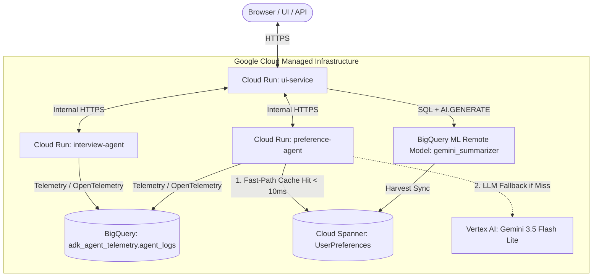

# Deploying `electric-sheep` to Google Cloud

This skill defines the complete operational guide, best practices, and mandatory workflows for deploying the **`electric-sheep` Google ADK 2.0 Multi-Agent Demo** to Google Cloud Run, Google Cloud Spanner, Google BigQuery, and Vertex AI.

---

## 🚨 Critical Operational Rules & Deployment Mandates

When modifying or deploying this repository, you **MUST** adhere to the following operational rules defined in [AGENTS.md](file:///Users/jasondavenport/GitHub/electric-sheep/AGENTS.md):

> [!IMPORTANT]
> 1. **Test in Deployed State**: Any code, UI, agent instruction, or prompt changes **MUST** be tested in the deployed state on Google Cloud Run. Local testing (`uv run pytest`) is required, but is **not sufficient on its own**.
> 2. **Deployment as the Final Step**: Deployment to Google Cloud Run using [deploy_cloud_run_source.sh](file:///Users/jasondavenport/GitHub/electric-sheep/scripts/deploy_cloud_run_source.sh) (or CI/CD) **MUST always be the final step** of any development, feature, or bugfix workflow.
> 3. **Validate Live Production Endpoints**: After deploying to Google Cloud Run, **always execute** `python3 -m scripts.validate_live_endpoints` to verify that all 7 live REST API endpoints respond correctly in the production environment (default project: `davenport-boutique`).
> 4. **Terraform Code Formatting & Validation**: Whenever editing or working with Terraform files in the [terraform/](file:///Users/jasondavenport/GitHub/electric-sheep/terraform) directory, you **MUST always run** `terraform validate` and `terraform fmt`.

---

## 🏛️ Architecture & Services Overview

The deployment consists of three standalone **Google Cloud Run** container services powered by the root [Dockerfile](file:///Users/jasondavenport/GitHub/electric-sheep/Dockerfile), supported by managed Google Cloud data services:



### Deployed Microservices
1. **`ui-service`** (`src.ui_service.server`): The Material Light UI Control Center and REST API gateway. Deployed with `--allow-unauthenticated` for public web browser and REST API access.
2. **`interview-agent`** (`src.interview_agent.server`): Google ADK 2.0 conversational agent that collects user preferences and records live telemetry. Deployed with `--no-allow-unauthenticated`.
3. **`preference-agent`** (`src.preference_agent.server`): Fast-path Google Cloud Spanner cache lookup agent. Checks Spanner first (`< 10ms` latency, zero LLM tokens) before falling back to Vertex AI Gemini. Deployed with `--no-allow-unauthenticated`.

For deep-dive technical specs on API payloads and data schemas, see [endpoints_and_architecture.md](file:///Users/jasondavenport/GitHub/electric-sheep/skills/deploy-google-cloud/references/endpoints_and_architecture.md).

---

## 🛠️ Prerequisites & Authentication

1. **Google Cloud CLI (`gcloud`)**: Ensure `gcloud` is installed and authenticated:
   ```bash
   gcloud auth login
   gcloud auth application-default login
   gcloud config set project davenport-boutique
   ```
2. **Container Runtime Note**: Local Docker installation is **not required**. Source deployments use **Google Cloud Build** remotely via `gcloud run deploy --source=.`. If local container testing is required, use `apple container` or your configured container engine.
3. **IAM Permissions**: The deploying identity must have permissions to deploy Cloud Run services, create Cloud Build executions, and interact with BigQuery, Spanner, and Vertex AI.

---

## 📖 How to Use the App (Control Center & Agent Walkthrough)

The **Material Light UI Control Center** provides an interactive dashboard to explore the multi-agent lifecycle, observe real-time telemetry, and test long-term memory consolidation.

### 1. Authenticating / Logging In
- Access the UI at [https://ui-service-834476222725.us-central1.run.app](https://ui-service-834476222725.us-central1.run.app) (or `http://localhost:8080` locally).
- **Google / Firebase Sign-In**: Click **Sign In with Google** if your email domain is authorized in `ALLOWED_EMAIL_DOMAINS`.
- **Local Developer Bypass**: When running in developer/mock mode (`USE_MOCK_CLIENTS=true`), click **Bypass Auth (Local Developer)** to enter immediately without external authentication.

### 2. Step-by-Step Application Workflow
1. **Interview Agent (Conversation & Telemetry)**:
   - Go to the **Interview Agent** tab.
   - Send conversational messages sharing personal preferences (e.g., name, favorite programming languages, technical stack, job role, and work style).
   - The agent records your answers and emits live OpenTelemetry spans and interaction logs to Google BigQuery (`adk_agent_telemetry.agent_logs`).
2. **Dream Harvest (REM Sleep Memory Consolidation)**:
   - Click **Trigger Dream Harvest** in the top navigation bar (or execute `POST /api/harvest`).
   - This initiates an asynchronous REM sleep memory synthesis pipeline:
     - BigQuery AI (`ML.GENERATE_TEXT` remote model) analyzes the conversation transcript and extracts structured JSON user profile preferences.
     - 768-dimensional vector embeddings are generated and upserted into **Google Cloud Spanner** (`UserPreferences`).
3. **Preference Agent (Fast Spanner Vector Cache Lookup)**:
   - Switch to the **Preference Agent** tab.
   - Ask questions about your stored profile (e.g., *"What is my favorite programming language and job role?"*).
   - Notice the cache hit (`source: "SPANNER_CACHE"`) returning in `< 10ms` via **vector similarity search (`COSINE_DISTANCE`)**, avoiding LLM inference latency and token costs.
4. **Inspect Memory & Logs**:
   - Check the **Spanner Memory** tab to inspect relational preferences and confidence scores.
   - Check the **Telemetry Logs** tab to view raw BigQuery interaction history.

---

## 💻 Running Locally with uv (CLI Walkthrough & Web Microservices)

You can run `electric-sheep` locally on your machine using `uv` either via an interactive command-line walkthrough or by launching the local FastAPI microservices.

### 1. Install Dependencies
```bash
uv sync --dev
```

### 2. Interactive CLI Walkthrough
Run the automated end-to-end multi-agent demonstration script in your terminal:
```bash
uv run python -m scripts.demo_flow
```

### 3. Running the Web Control Center Locally
Launch the three microservices in separate terminals. By default, local execution uses deterministic mock mode (`USE_MOCK_CLIENTS=true`), so no Google Cloud credentials or network connections are required:
```bash
# Terminal 1: InterviewAgent
uv run uvicorn src.interview_agent.server:api --port 8081 --reload

# Terminal 2: PreferenceAgent
uv run uvicorn src.preference_agent.server:api --port 8082 --reload

# Terminal 3: UI Service (Material Light Control Center)
uv run uvicorn src.ui_service.server:api --port 8080 --reload
```
Once running, open `http://localhost:8080` in your browser.

---

## 🚀 Workflow 1: Source Deployment (Recommended for Features & Updates)

Use [deploy_cloud_run_source.sh](file:///Users/jasondavenport/GitHub/electric-sheep/scripts/deploy_cloud_run_source.sh) to build and deploy all three microservices directly from source using the root [Dockerfile](file:///Users/jasondavenport/GitHub/electric-sheep/Dockerfile).

### 1. Standard Deployment (Default Project: `davenport-boutique`)
From the repository root, run:
```bash
./scripts/deploy_cloud_run_source.sh
```

### 2. Custom Environment / Project Deployment
You can override deployment parameters using shell environment variables before invoking the script (see [custom_env_deploy.sh](file:///Users/jasondavenport/GitHub/electric-sheep/skills/deploy-google-cloud/examples/custom_env_deploy.sh)):
```bash
export GOOGLE_CLOUD_PROJECT="your-gcp-project-id"
export GOOGLE_CLOUD_REGION="us-central1"
export MODEL_NAME="gemini-3.8-flash"
export BQ_DATASET_ID="adk_agent_telemetry"
export SPANNER_INSTANCE_ID="adk-spanner-instance"
export SPANNER_DATABASE_ID="agent_memory_db"

# Optional Identity-Aware Proxy (IAP) & reverse proxy configuration
export IAP_ENABLED="true"
export IAP_EXPECTED_AUDIENCE="/projects/YOUR_PROJECT_NUMBER/global/backendServices/YOUR_BACKEND_SERVICE_ID"
export IAP_HEADER_NAME="x-goog-iap-jwt-assertion"
export IAP_PROXY_URL="https://app.example.com"

./scripts/deploy_cloud_run_source.sh
```

> [!NOTE]
> - The deployment script automatically loads local `.env` variables if `.env` is present in the repository root (excluded by `.gitignore`), preventing sensitive secrets from being committed while ensuring production values are used during deployment.
> - The script automatically injects `USE_MOCK_CLIENTS=false` so that services connect to real Google Cloud Spanner, BigQuery, and Vertex AI endpoints in production.

---

## 🏗️ Workflow 2: Terraform IaC (Recommended for Initial Setup & Infrastructure)

The [terraform/](file:///Users/jasondavenport/GitHub/electric-sheep/terraform) directory contains complete Infrastructure as Code (IaC) to provision APIs, BigQuery datasets/tables, Spanner instances/databases, IAM roles, and Cloud Run services.

### Step-by-Step Terraform Instructions
1. **Change to the Terraform Directory**:
   ```bash
   cd terraform
   ```
2. **Initialize Terraform**:
   ```bash
   terraform init
   ```
3. **Format & Validate (MANDATORY RULE)**:
   > [!IMPORTANT]
   > You **MUST** run `terraform fmt` and `terraform validate` whenever working with Terraform files.
   ```bash
   terraform fmt
   terraform validate
   ```
4. **Generate Execution Plan**:
   ```bash
   terraform plan -out=tfplan
   ```
   *(For custom variable overrides, see [terraform.tfvars.example](file:///Users/jasondavenport/GitHub/electric-sheep/skills/deploy-google-cloud/examples/terraform.tfvars.example))*
5. **Apply Infrastructure**:
   ```bash
   terraform apply tfplan
   ```

---

## 🧪 Mandatory Deployed State Validation

After deployment completes, you **MUST** validate that all live production endpoints are healthy and responding correctly.

### 1. Execute Programmatic Validator Script
Run the automated live endpoint verification suite from the repository root:
```bash
python3 -m scripts.validate_live_endpoints
```

### 2. Verified Endpoints Checklist
The validator script verifies the following **7 live REST API endpoints** and core pages:

| Endpoint | Method | Service | Purpose | Expected Response |
| :--- | :--- | :--- | :--- | :--- |
| `/health` | `GET` | All 3 Services | Liveness check | `200 OK` (`{"status": "ok", ...}`) |
| `/login.html` | `GET` | `ui-service` | Firebase Web Auth login page | `200 OK` (HTML page) |
| `/` | `GET` | `ui-service` | Main Control Center UI | `200 OK` (HTML page) |
| `/api/interview/query` | `POST` | `ui-service` -> `interview-agent` | Chat with InterviewAgent & emit BQ telemetry | `200 OK` (`{"response": "...", "metadata": ...}`) |
| `/api/logs/{session_id}` | `GET` | `ui-service` -> BigQuery | Fetch BigQuery telemetry logs | `200 OK` (`{"logs": [...]}`) |
| `/api/harvest` | `POST` | `ui-service` -> BigQuery AI -> Spanner | Trigger Dream Harvest REM memory consolidation | `200 OK` (`{"status": "success", ...}`) |
| `/api/spanner/preferences/{user_id}` | `GET` | `ui-service` -> Cloud Spanner | Retrieve stored user profile preferences | `200 OK` (`{"preferences": [...]}`) |
| `/api/preference/query` | `POST` | `ui-service` -> `preference-agent` | Query preference agent (fast Spanner cache hit) | `200 OK` (`{"response": "...", "source": "SPANNER_CACHE"}`) |

### 3. UI Layout Integrity Verification
If you modified UI HTML/CSS or navigation in [src/ui_service/](file:///Users/jasondavenport/GitHub/electric-sheep/src/ui_service), verify layout integrity against [DESIGN.md](file:///Users/jasondavenport/GitHub/electric-sheep/DESIGN.md) rules before deployment:
```bash
uv run pytest tests/test_ui_service.py -k test_ui_service_topbar_and_layout_integrity -v
```

---

## 🔍 Troubleshooting & Common Deployment Issues

### 1. `403 Forbidden` / Authentication Errors on Inter-Service Calls
- **Symptom**: `ui-service` cannot reach `interview-agent` or `preference-agent`.
- **Root Cause**: `interview-agent` and `preference-agent` are deployed with `--no-allow-unauthenticated`.
- **Solution**: Ensure the Cloud Run service account assigned to `ui-service` has the `roles/run.invoker` IAM role on both backend agent services, or verify identity token headers in client requests.

### 2. Spanner Database or Table NotFound
- **Symptom**: Error `500` on `/api/spanner/preferences/{user_id}` or during Dream Harvest.
- **Solution**: Verify that the Google Cloud Spanner instance (`SPANNER_INSTANCE_ID`) and database (`SPANNER_DATABASE_ID`) exist. Apply DDL schemas via Terraform (`terraform apply`) or check [spanner.tf](file:///Users/jasondavenport/GitHub/electric-sheep/terraform/spanner.tf).

### 3. BigQuery Remote Model / Summarizer Failure
- **Symptom**: `/api/harvest` returns SQL execution error for `gemini_summarizer`.
- **Solution**: Verify that BigQuery ML Remote Model connection (`bigqueryconnection.googleapis.com`) is enabled and that the BigQuery service account has Vertex AI user access (`roles/aiplatform.user`).

### 4. Local Test Mocking vs Production
- **Symptom**: Deployed service returns mock/fake data instead of live Cloud Spanner/BigQuery results.
- **Solution**: Ensure `USE_MOCK_CLIENTS=false` is explicitly passed in the `--set-env-vars` flag of the Cloud Run deployment command.
