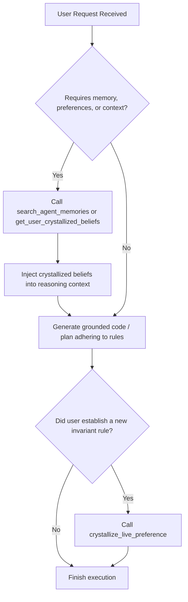

# Electric Sheep Memory Retrieval Skill

> [!NOTE]
> This skill integrates Google Antigravity with the **Electric Sheep v2** Cloud Spanner Crystalline Memory matrix.
> Memory is served via the `electric-sheep-memory` Model Context Protocol (MCP) server running against Spanner instance `adk-spanner-instance:agent_memory_db` in project `davenport-boutique`.

---

## 1. Available Tools (via `electric-sheep-memory` MCP)

When this skill is active, you have access to the following MCP tools:

1. **`get_user_crystallized_beliefs(user_id, category)`**:
   - Fetches permanent crystallized beliefs and preferences (e.g. `favorite_language`, `preferred_tools`, `hardware_target`, `test_runner`).
   - Use `category` to filter: `'technical'`, `'infrastructure'`, `'tooling'`, `'profile'`, `'style'`, or `'intent'`.

2. **`get_recent_session_memory(user_id, session_id)`**:
   - Fetches executive summaries and active working goals from recent sessions stored in `UserSessionSummaries`.

3. **`search_agent_memories(query, user_id, limit)`**:
   - Executes semantic vector cosine similarity search across Cloud Spanner memories.
   - Ideal when the user asks a question like *"what tools do I prefer for testing?"* or *"what was our architecture decision on caching?"*.

4. **`crystallize_live_preference(user_id, preference_key, preference_value, category, crystallized_belief)`**:
   - Permanently commits a new rule, preference, or architectural invariant to Spanner with commit timestamps.

---

## 2. Progressive Disclosure Workflow

---

## 3. Best Practices & Invariants

- **Default User ID**: Use `demo-user-42` (or the specific authenticated user ID if provided).
- **Sub-10ms Fast Retrieval**: Cloud Spanner queries are indexed on `(UserId, PreferenceKey)` and vector similarity over 768-dim embeddings.
- **Strict Grounding**: Never guess user preferences when they are stored in Spanner. Retrieve them first before proposing architectural solutions or selecting tools.
