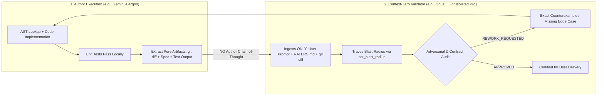

# Subagent Delegated Execution Skill: Model-Aware Delegation & Cross-Model Validation

> [!IMPORTANT]
> **Model-Aware & AST-First Mandate**:
> Subagent delegation is **not** a blind one-size-fits-all rule. Every subagent invocation pays a **`~8k–15k` token cold-start tax** (re-sending system prompts, tool schemas, and rules) and introduces handoff compression.
> - **Never spawn a subagent** for symbol lookups, reference tracing, or bounded 1–4 file edits when running a **Frontier Reasoning Model (`gemini-4-argon`, `claude-opus-5.5`)** with **`ast-graph`** available.
> - **Always spawn a subagent** to quarantine high-entropy noise (verbose logs, Playwright DOM trees, transcript forensics), execute parallel decoupled workstreams, or perform **context-zero / cross-model validation**.

---

## 1. Token Economics & The AST GraphDB Calculus

### Why Unconditional Delegation Wastes Tokens on Frontier Models
1. **Cold-Start Overhead**: Spawning a Worker subagent + a Rater subagent duplicates `16k–30k` tokens of system instructions and tool declarations that the root agent already holds in its KV-cache.
2. **AST GraphDB Eliminates "Read Bloat"**: Historically, read tasks were delegated to subagents because reading 5 raw files dumped `1,500+` lines into the root window. With `ast-graph` (`ast_symbol`, `ast_refs`, `ast_outline`, `ast_blast_radius`), locating exact definitions, mutations, and line spans (`filePath#L42-L78`) costs **`<500` tokens**—making direct root execution **5x–10x cheaper and higher-coherence** than spawning a read subagent.
3. **Lossy Handoffs ("Telephone Game")**: Summarizing subtle cross-file state invariants into a subagent prompt risks dropping edge-case constraints that a frontier root model already understands.

### Where Subagent Delegation Still Wins Massively
1. **High-Entropy Noise Quarantine**: A `flash` subagent (`gemini-3.8-flash` / `gemini-3.5-flash-lite`) absorbing `40k` tokens of failing test logs, Cloud Run stack traces, or Playwright accessibility snapshots and returning a `300`-token root-cause summary prevents the root model from re-paying for those `40k` tokens on every subsequent turn.
2. **Parallel Fan-Out**: Editing or auditing $N$ independent packages concurrently in `branch` or `share` workspaces reduces wall-clock latency and isolates intermediate trial-and-error diffs.
3. **Eliminating Self-Confirmation Bias**: A model that wrote code in Turn 3 is cognitively primed to believe its code is correct in Turn 4. Only a fresh context window—ideally backed by an **orthogonal model or equal/higher reasoning tier**—provides an unbiased audit.

---

## 2. Model-Tier Adaptive Delegation Matrix

Choose **Direct Root Execution** vs. **Subagent Delegation** based on the **Root Orchestrator's active model tier**:

| Task Category | Frontier Reasoning Root<br>(`gemini-4-argon`, `claude-opus-5.5`) | Workhorse Coding Root<br>(`claude-sonnet-5.5`) | High-Throughput Root<br>(`gemini-3.8-flash`, `gemini-3.5-flash-lite`) |
| :--- | :--- | :--- | :--- |
| **Symbol Lookup, Refs & Blast Radius** | **Direct in Root** via `ast_symbol`, `ast_refs`, `ast_outline`, `ast_blast_radius` (`<500` tokens). | **Direct in Root** via `ast-graph` tools. | **Direct in Root** via `ast-graph` tools (never raw-read whole files). |
| **Bounded Code Reads (`1–4` files, `<250` lines via AST spans)** | **Direct in Root** (`read_file` with exact `StartLine`/`EndLine`). | **Direct in Root** (`read_file` with exact `StartLine`/`EndLine`). | **Direct in Root** up to 2 files; **Delegate** (`research` / `flash`) if synthesizing 3+ files. |
| **Broad Unindexed Exploration / Log Forensics / Transcripts / Web** | **Delegate to `flash`** (`research` or `self`) to compress noisy output into a `<400`-token briefing. | **Delegate to `flash`** to prevent mid-session context drift. | **Delegate to isolated `flash` subagents** (one subagent per log/domain) to prevent prompt overflow. |
| **Cohesive Feature / Bugfix (`1–4` tightly coupled files)** | **Direct in Root** (preserves full cross-file coherence and KV-cache; zero handoff loss). | **Direct in Root** for `1–2` files; **Delegate** if touching 3+ subsystems. | **Delegate to `pro` (`gemini-4-argon` / `opus-5.5`)** if logic involves state machines, concurrency, or security; otherwise isolated `self` worker. |
| **Multi-Package Refactor or Parallel Independent Modules** | **Delegate Parallel Workers** (`Model: "inherit"`, `Workspace: "branch"` or `"share"`). | **Delegate Parallel Workers** (`Model: "inherit"` or `"pro"`). | **Delegate to `pro` Workers** per module; keep root strictly as dispatcher. |
| **Targeted Fast Unit Tests (`npx vitest run <file>`, `uv run pytest <file>`)** | **Direct in Root** when output is clean (`<50` lines). | **Direct in Root** when output is clean. | **Delegate to `flash` Verification Runner** so tracebacks do not derail root state. |
| **Full Suite / Flaky / E2E Playwright / Cloud Build Runs** | **Delegate to `flash` Verification Runner** (quarantines verbose logs & browser traces). | **Delegate to `flash` Verification Runner**. | **Delegate to `flash` Verification Runner**. |
| **Post-Implementation Validation & Rating** | **Skip Rater** on routine 1–2 file edits with passing tests; **Use Orthogonal / `pro` Validator** for complex/critical features. | **Pair with `pro` Validator** (`gemini-4-argon` or `opus-5.5`) on multi-file or architectural changes. | **Mandatory `pro` Validator** (`gemini-4-argon` or `opus-5.5`) on all non-trivial code changes. |

### Per-Model Operational Rules

#### A. When Running `gemini-4-argon` or `claude-opus-5.5` (Frontier Reasoning Tier)
- **Default Posture**: **High-Agency Direct Execution + Surgical Subagent Offloading**.
- Do **not** wrap simple `ast-graph` lookups, 2-file bug fixes, or fast unit test runs in subagents.
- Use `flash` (`gemini-3.8-flash`) subagents strictly as **entropy sponges** (log parsing, live endpoint scraping, broad searches) and `pro` / cross-model subagents for **parallel fan-out** or **adversarial verification**.

#### B. When Running `claude-sonnet-5.5` (Workhorse Coding Tier)
- **Default Posture**: **Direct on Scoped Tasks + Subagent Isolation on Multi-Subsystem Work**.
- `sonnet-5.5` excels at fast, direct 1–2 file edits when guided by `ast-graph`, but exhibits higher context drift once raw terminal outputs and multi-package edits exceed `~35k` tokens.
- Offload multi-package refactors to isolated subagents and escalate architectural review or complex edge-case validation to a **`pro` (`gemini-4-argon` / `opus-5.5`)** validator.

#### C. When Running `gemini-3.8-flash` or `gemini-3.5-flash-lite` (High-Throughput Tier)
- **Default Posture**: **Strict Decomposition + Up-Tier Escalation**.
- Keep the root context ultra-compact. Decompose multi-step requests into narrow single-objective subagents.
- Whenever a task requires intricate concurrency control, schema migration, security sanitization, or root-cause synthesis across many files, **escalate the Worker or Validator to `Model: "pro"` (`gemini-4-argon` / `opus-5.5`)**.

---

## 3. Cross-Model & Orthogonal Validation (e.g., Opus 5.5 Validates Gemini 4 Argon)

> [!CAUTION]
> **Anti-Pattern: Never Use a Weaker Model to Critique a Frontier Model's Architecture**
> Do **not** use a `flash` Rater to judge the semantic or architectural correctness of code written by `gemini-4-argon` or `claude-opus-5.5`. A `flash` subagent should only verify **mechanical checklists** (test suite exit codes, `file://` link formatting, lint status). Semantic, security, and architectural validation requires an **equal-tier (`pro`) or cross-family model**.

### Why Cross-Model Validation Works (Orthogonal Error Decorrelation)
Every model family has distinct inductive biases learned during pre-training and RLHF:
- **Same-Model Blindness**: If `gemini-4-argon` writes a subtle race condition or makes an implicit schema assumption, a second `gemini-4-argon` instance prompted the same way shares the same priors and is more likely to overlook the same blind spot.
- **Cross-Model Decorrelation (`gemini-4-argon` $\leftrightarrow$ `claude-opus-5.5` / `claude-sonnet-5.5`)**:
  - **Gemini 4 Argon** excels at global repo-wide dependency synthesis, strict numerical/protocol invariants, and multi-hop systems tracing.
  - **Claude Opus 5.5 / Sonnet 5.5** excels at defensive control-flow pedantry, local state-machine boundary exhaustion, and ergonomic API surface critique.
  - Pairing one as **Builder** and the other as **Blind Validator** catches significantly more real defects than running two instances of the same model.



### The 3 Rules of Orthogonal Validation

1. **Context-Zero Information Barrier (Strip Author Reasoning)**:
   - When dispatching a Validator/Rater subagent, **never** pass the author's narrative explanation of *why* the code works ("I handled X by doing Y..."). Explanations prime the validator to agree.
   - Pass **only**:
     1. The verbatim original user requirement.
     2. The repository's `RATERS.md` / `AGENTS.md` invariants.
     3. The objective diff (`git diff`) and modified file paths.
     4. The raw test command and exit result.
2. **Recommended Builder $\rightarrow$ Validator Pairings**:
   | Builder Model | Recommended Validator | Validation Focus |
   | :--- | :--- | :--- |
   | **`gemini-4-argon`** | **`claude-opus-5.5`** (cross-family) or isolated context-zero **`pro`** | Local state-machine edge cases, null/error propagation, UI/UX affordance regressions, and race conditions. |
   | **`claude-opus-5.5`** | **`gemini-4-argon`** (cross-family) or isolated context-zero **`pro`** | Cross-package protocol/schema lineage (`ast_lineage`), GCP/Terraform production invariants, and system-wide blast radius. |
   | **`claude-sonnet-5.5`** | **`gemini-4-argon`** or **`claude-opus-5.5`** (`Model: "pro"`) | Architectural drift across files, incomplete blast-radius updates, and subtle contract violations. |
   | **`gemini-3.8-flash`** | **`gemini-4-argon`** or **`claude-opus-5.5`** (`Model: "pro"`) | Full logic audit, edge-case completeness, mock prohibition compliance, and test adequacy. |
3. **Two-Tier Rating Split (Mechanical vs. Semantic)**:
   - **Mechanical Gate (`Model: "flash"`)**: Fast, cheap check that `npm test` / `uv run pytest` exited `0`, `terraform validate` passed, no mocks were introduced, and `docs/` parity holds.
   - **Semantic / Adversarial Gate (`Model: "pro"` / Cross-Model)**: Deep logic, concurrency, security, and specification audit reserved for non-trivial features, multi-file refactors, and production deployments.

---

## 4. Subagent Archetypes & Model Assignment

| Archetype | TypeName | Model Parameter | Ideal Underlying Model | Primary Mission |
| :--- | :--- | :--- | :--- | :--- |
| **Entropy Sponge / Log & Web Explorer** | `research` or `self` | `flash` | `gemini-3.8-flash` / `gemini-3.5-flash-lite` | Digesting noisy build logs, Cloud Run logs, Playwright dumps, transcripts, or broad unindexed searches into `<400`-token briefings. |
| **Parallel Module Implementer** | `self` | `inherit` (on Argon/Opus root) | `gemini-4-argon` / `claude-opus-5.5` / `claude-sonnet-5.5` | Implementing an isolated subsystem in a `branch` or `share` workspace with self-contained unit tests. |
| **Mechanical Verification Runner** | `self` | `flash` | `gemini-3.8-flash` | Running full test suites, linters, Playwright smoke probes, and reporting a compact pass/fail matrix. |
| **Orthogonal Semantic Validator (Rater)** | `self` | `inherit` (on Argon/Opus root) | Cross-family (`opus-5.5` $\leftrightarrow$ `gemini-4-argon`) or context-zero frontier | Blind audit of `git diff` + `RATERS.md` + user prompt with zero exposure to author's chain-of-thought. |
| **Adversarial Challenger** | `self` | `inherit` (on Argon/Opus root) | `gemini-4-argon` / `claude-opus-5.5` | Boundary fuzzing, concurrency/race injection, and security/armor bypass probing (see `adversarial-subagent-challenger`). |

---

## 5. Generalized Subagent Prompt Templates

### Template A: Entropy Sponge / Noisy Exploration (`flash`)
> Use **only** when `ast-graph` cannot answer the question directly in `<500` tokens (e.g., log forensics, transcript search, external web docs, or 10+ unindexed files).

```json
{
  "TypeName": "research",
  "Role": "Log & Codebase Forensics Investigator",
  "Model": "flash",
  "Prompt": "Investigate <SUBSYSTEM_OR_FAILURE_LOG>.\n\nCONSTRAINTS:\n1. Use `ast_symbol`, `ast_refs`, or `ast_outline` first before reading source files.\n2. Do NOT dump raw files or full logs back to the parent.\n3. Return a <400-token structured briefing containing: root cause, exact interface contracts, and clickable `file://` links with line spans (`#L<start>-L<end>`)."
}
```

### Template B: Parallel Module Implementation (`inherit`)
> Use `Model: "inherit"` when the root model is already `gemini-4-argon` or `claude-opus-5.5` (Note: `Model: "pro"` in `invoke_subagent` only applies when escalating from a `flash` root session; on a frontier root session, `"inherit"` preserves `gemini-4-argon` / `opus-5.5` directly and avoids regional `locations/us` alias 404s).

```json
{
  "TypeName": "self",
  "Role": "Subsystem Implementer",
  "Model": "inherit",
  "Workspace": "inherit",
  "Prompt": "Implement <FEATURE_OR_BUGFIX> in <TARGET_FILES>.\n\nREQUIREMENTS:\n1. Run `ast_blast_radius` and `ast_tests_for` on modified symbols before and after editing.\n2. Strictly satisfy all invariants in `RATERS.md` and `AGENTS.md` (zero mocks, real execution).\n3. Add or update unit tests in <TEST_FILES> and verify via `<PROJECT_TEST_COMMAND>`.\n\nReturn: 1) Modified files with `file://` line links, 2) Exact test command & pass/fail output, 3) Any cross-module assumptions."
}
```

### Template C: Context-Zero Orthogonal Validator (`inherit` / Cross-Model)
> Notice that the worker's narrative summary is **intentionally omitted**—the validator inspects the live `git diff`, `ast_blast_radius`, and test results directly. Always use `Model: "inherit"` when running on a frontier root (`gemini-4-argon` / `opus-5.5`).

```json
{
  "TypeName": "self",
  "Role": "Orthogonal Specification & Diff Validator",
  "Model": "inherit",
  "Workspace": "inherit",
  "Prompt": "Perform a Context-Zero Orthogonal Audit of the current workspace changes.\n\nORIGINAL USER REQUIREMENT:\n<INSERT_VERBATIM_USER_PROMPT>\n\nAUDIT PROTOCOL (Do NOT trust prior assumptions):\n1. Inspect the exact code changes via `git diff` and check upstream impact via `ast_blast_radius` on modified symbols.\n2. Verify every requirement in the Original User Requirement and repository `RATERS.md` / `AGENTS.md`.\n3. Check for: unhandled edge cases, race conditions, missing error propagation, mock/fallback violations, and doc-code-test parity.\n4. Run `<PROJECT_TEST_COMMAND>` to independently confirm verification proof.\n\nReturn a structured report:\n- **Verdict**: [APPROVED | REWORK_REQUESTED]\n- **Scorecard (1-5)**: Prompt Fidelity, Invariant Compliance, Edge-Case Soundness, Verification Proof\n- **Concrete Defects / Counterexamples** (with exact `file://` line links)\n- **Remediation Directives** (if REWORK_REQUESTED)"
}
```

---

## 6. Decision Checklist Before Spawning Any Subagent

> [!TIP]
> **Pre-Dispatch Gate**:
> 1. **Can `ast-graph` answer this in `<500` tokens?** If yes (`ast_symbol`, `ast_refs`, `ast_outline`, `ast_blast_radius`), execute **directly in the root agent**—do not spawn a read subagent.
> 2. **Is the root model `gemini-4-argon` or `claude-opus-5.5` editing `1–4` cohesive files?** If yes, edit and run targeted tests **directly in the root agent** to avoid cold-start token tax and handoff loss.
> 3. **Will this tool call produce `>5k` tokens of noisy output (logs, Playwright DOM, full test suite)?** If yes, delegate to a `flash` (`gemini-3.8-flash`) subagent to quarantine the entropy.
> 4. **Does this change require high-assurance validation?** If yes, dispatch a **Context-Zero Orthogonal Validator** (`Model: "inherit"` on Argon/Opus roots so it inherits the active frontier model without hitting `locations/us` `gemini-3.1-pro-preview` 404s, or cross-family CLI/agent) given only the user prompt, `RATERS.md`, and `git diff`—never a downgraded model reviewing a frontier model's reasoning.
